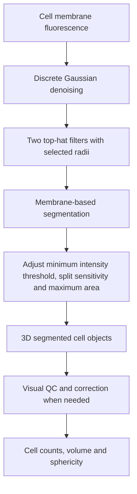

# Membrane-based cell segmentation

A pretrained Cellpose cell model was proposed in the initial planning slide, but the supplied methodology does not establish that it was used in the final cell segmentation workflow.
