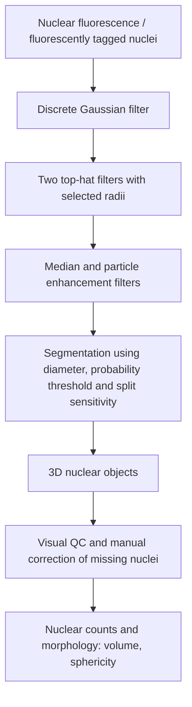
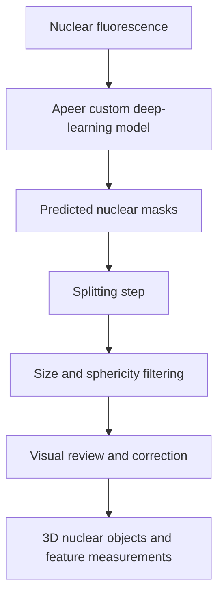

# 3D nuclear segmentation

## Alternative deep-learning approach shown in the project figures

The figures indicate that the custom Apeer model could be improved with additional reference images and annotations. No validated model performance metric was supplied.
