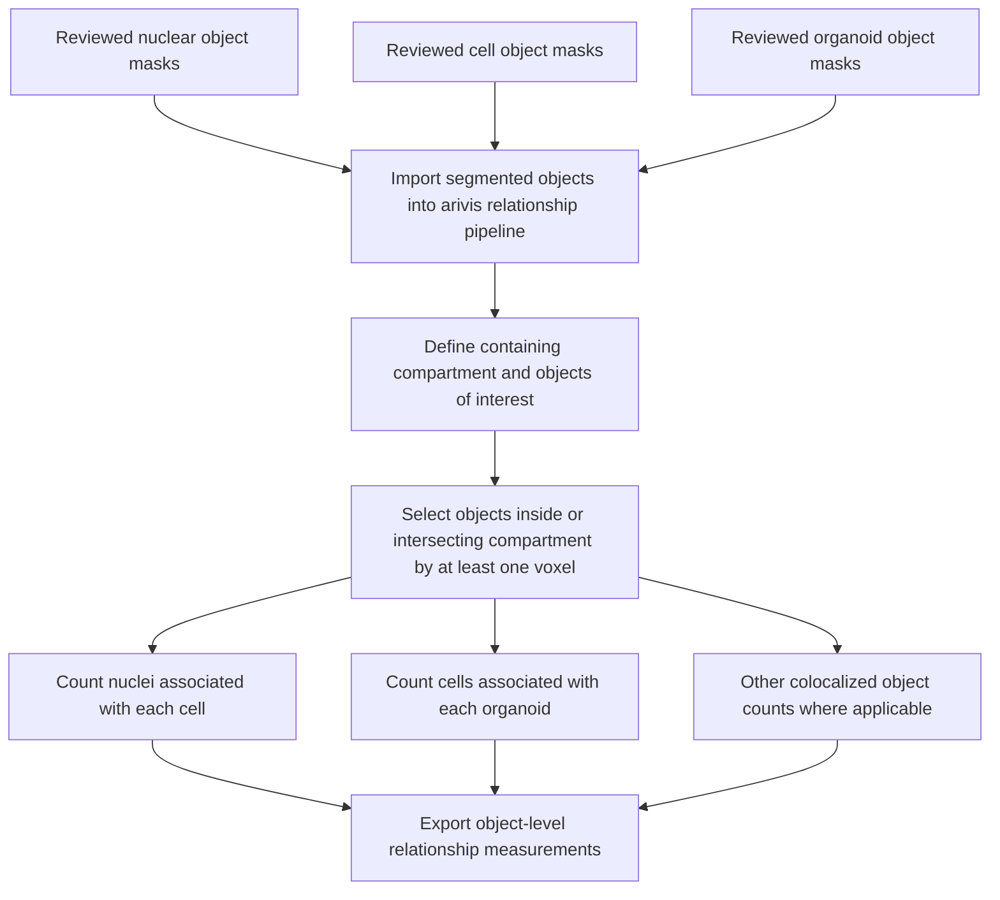

# Spatial relationship analysis

The one-voxel intersection criterion is a spatial association rule, not necessarily proof of complete biological containment. The precise treatment of objects intersecting multiple compartments is not specified in the supplied methods.
